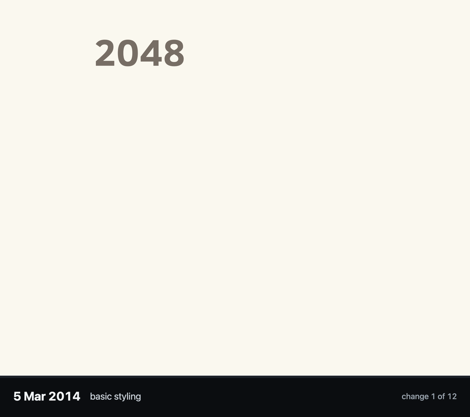

# uilapse

Turn a repo's git history into a time-lapse video of its interface evolving, commit by commit.

```bash
npx uilapse
```

Run it inside any web project. It walks through the history, runs the app as it was at each commit, takes a screenshot, and stitches the screenshots into an MP4 with the date and commit message under each frame.



*[2048](https://github.com/gabrielecirulli/2048) by Gabriele Cirulli: 134 commits, filmed with one command.*

## What it does

- **Runs the real app at each commit.** Plain HTML is served directly. Projects with a `dev` or `start` script are started and captured once they answer.
- **Follows the project as it changes.** How to run the app is worked out again for every commit, so a history that begins as one HTML file and later becomes a Vite or Next.js app still films from start to finish.
- **Keeps only what changed.** Each screenshot is compared with the last one kept, and commits that changed nothing you can see are dropped. Commits that fail to install or start are skipped and listed.
- **Ends on a comparison.** The film closes with the first and latest versions side by side.
- **Leaves your repo alone.** All work happens in a temporary git worktree that is removed afterwards. Your working tree, branch and uncommitted changes are not touched.
- **Stays on your machine.** Nothing is uploaded.

## Requirements

- Node.js 20 or newer
- git
- ffmpeg (`brew install ffmpeg`, `apt install ffmpeg`, `winget install ffmpeg`)
- Chromium for Playwright: `npx playwright install chromium`

## Usage

```bash
uilapse [repo] [options]
```

```bash
# The last three months, 40 commits, plus a GIF
uilapse --since "3 months ago" -n 40 --gif

# Phone-sized, dark theme, the /pricing page
uilapse --mobile --dark --path /pricing

# An app in a subfolder that needs an untracked env file
uilapse --cwd apps/web --copy apps/web/.env.local

# A site that must be built, then served from dist
uilapse --build "npm run build" --dir dist

# Only commits that touched the interface
uilapse --only src/components --only src/app
```

| Option | Meaning | Default |
| --- | --- | --- |
| `-o, --out <file>` | Video file to write | `uilapse.mp4` |
| `--gif` | Also write a GIF next to the video | off |
| `--keep-frames <dir>` | Save the captioned frames as PNGs | off |
| `-n, --frames <n>` | Most commits to capture, spread evenly over the range | `60` |
| `--since`, `--until <date>` | Limit the range (any date git accepts) | whole history |
| `--only <path>` | Only commits that touched this path (repeatable) | all |
| `--cmd <command>` | Command that starts the app | auto |
| `--install <command>` | Command that installs dependencies | auto |
| `--build <command>` | Build first, then serve `--dir` as static files | none |
| `--dir <folder>` | Folder of static files to serve | auto |
| `--cwd <folder>` | Folder inside the repo where the app lives | repo root |
| `--copy <file>` | Copy an untracked file into each commit (repeatable) | none |
| `--path <path>` | Page to capture | `/` |
| `--timeout <sec>` | How long to wait for the app to start | `90` |
| `--wait <ms>` | Extra pause before each screenshot | `600` |
| `--width`, `--height <px>` | Viewport size | `1280` x `800` |
| `--mobile` | Phone viewport, 390 x 844 with touch | off |
| `--dark` | Ask the page for its dark theme | off |
| `--scale <n>` | Pixel density; `2` gives a sharper video | `1` |
| `--hold <sec>` | Time each commit stays on screen | `0.6` |
| `--end-hold <sec>` | Time the final frame stays on screen | `2.5` |
| `--min-change <pct>` | Drop commits that changed less than this share of the picture | `0.1` |
| `--keep-duplicates` | Keep every commit, even with no visible change | off |
| `--no-end-card` | Leave out the closing first-versus-latest card | off |
| `--gif-width <px>` | Width of the GIF | `960` |
| `-v, --verbose` | Print full errors for skipped commits | off |

## Use it from Claude Code

This repo is also a Claude Code plugin with a skill that teaches Claude when and how to run `uilapse`.

```
/plugin install uilapse --marketplace Suryansh-Codes2209/uilapse
```

Then ask Claude for things like "film how this app's interface changed over the last three months".

For other agents that read skills, copy the `skills/uilapse` folder into the agent's skills directory.

## How it works

1. `git log --first-parent` lists the commits, and up to `--frames` of them are picked evenly across the range.
2. A temporary worktree is checked out at each picked commit.
3. Dependencies are installed only when `package.json` or the lockfile changed since the last captured commit.
4. The app is started on a free port. The address is read from what the dev server prints, so frameworks that choose their own port still work.
5. Playwright takes the screenshot, and it is kept only if enough of the picture differs from the last kept frame.
6. A caption bar is added to each kept frame, and ffmpeg holds each one and cross-fades into the next.

## Limits

- It runs code from your repo's history, including old install scripts. Use it on repos you trust.
- Old commits often no longer install, because registries and Node versions move on. Those commits are skipped; `--verbose` shows why.
- Apps that need a database, a login or secret keys to render anything will show an error page or be skipped. `--copy` helps with env files.
- Pages with random content (a shuffled board, a rotating quote) look different on every load. Raise `--min-change` so that noise is not counted as a change.
- One page per run. Run it again with a different `--path` for another page.
- Histories with many dependency changes are slow, because each change means a fresh install.

## Development

```bash
npm install
npx playwright install chromium
npm test
```

The test builds a throwaway repo whose history goes from a single HTML file to an app with a dev server, films it, and checks the result.

## License

MIT
